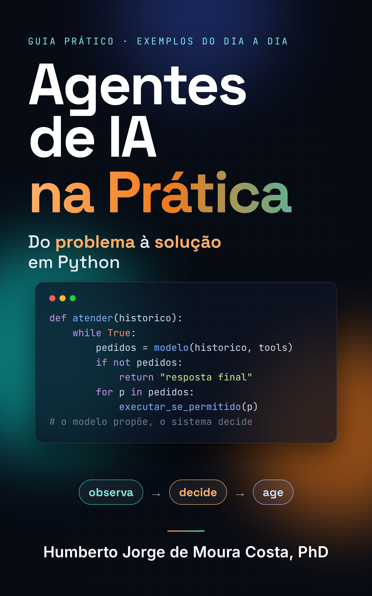

<div align="center">
  <a href="https://www.amazon.com.br/dp/B0HMZ3N4C4">
  
  </a>
</div>

# Agentes de IA na Prática

**Do problema à solução em Python — código-fonte e exemplos do livro**


[](LICENSE)


> **Todo mundo fala de agentes de IA. Este livro mostra como construir um, passo a passo.**
>
> Aqui você encontra os exemplos de *Agentes de IA na Prática: Do problema à solução em Python*, de **Humberto Jorge de Moura Costa**. A proposta é compreender e implementar os mecanismos internos de um agente antes de depender das abstrações de um framework.

**Edições do livro:** 

[Kindle — Amazon Brasil](https://www.amazon.com.br/dp/B0HMZ3N4C4)

[Livro impresso - Amazon EUA](https://www.amazon.com/-/pt/dp/B0HN46ZQBF)


O livro apresenta os fundamentos e a construção progressiva
de agentes de IA em Python. Este repositório disponibiliza
os exemplos práticos e os testes automatizados.


O fio condutor é a **padaria da Dona Cida**, um cenário didático que evolui de decisões simples para ferramentas, aprovação humana, memória e consulta a documentos.

**O que esperar deste repositório:**

- **5 exemplos progressivos e independentes**, correspondentes aos capítulos práticos do livro.
- **Código em Python**, acompanhado de saídas esperadas e testes automatizados.
- **Execução local sem chave de API** para os cinco exemplos didáticos. Uma demonstração adicional do capítulo 15 utiliza a API da OpenAI.
- **Foco nos fundamentos:** os exemplos ilustram componentes de agentes, não um sistema integrado pronto para produção.

## Exemplos por capítulo

| Parte | Capítulo | O que você vai explorar | Pasta |
|---|---:|---|---|
| **1 · Fundamentos** | 8 | Agente reativo baseado em regras, observação e estado interno, sem LLM | [`parte1_cap08_ar_condicionado`](comercial/parte1_cap08_ar_condicionado) |
| **2 · Ciclo do agente** | 15 | Chamadas de ferramentas, controle do ciclo e comparação entre simulação e uso de LLM real | [`parte2_cap15_atendente`](comercial/parte2_cap15_atendente) |
| **3 · Ferramentas** | 24 | Validação, aprovação humana, retomada e prevenção de operações duplicadas | [`parte3_cap24_ferramentas`](comercial/parte3_cap24_ferramentas) |
| **4 · Contexto e memória** | 33 | Seleção, atualização, validade, controle de acesso e compactação da memória | [`parte4_cap33_caderno`](comercial/parte4_cap33_caderno) |
| **5 · Recuperação de informações** | 42 | Busca didática em documentos, filtros de acesso, citações e respostas sem evidências | [`parte5_cap42_pasta`](comercial/parte5_cap42_pasta) |

Cada pasta contém um arquivo `saida_esperada.txt`. Os testes conferem se as cinco demonstrações locais produzem as saídas registradas nesses arquivos.

## Comece por aqui

### 1. Prepare o ambiente

Você precisa de **Python 3.11 ou superior** e, para clonar o repositório, do Git. O apêndice *Prepare seu ambiente*, no final do livro, explica a configuração passo a passo.

```bash
git clone https://github.com/humbertomoura/agentes-ia-livro.git
cd agentes-ia-livro
python -m venv .venv
```

Ative o ambiente virtual **conforme seu sistema operacional**:

**Linux/macOS**

```bash
source .venv/bin/activate
```

**Windows (PowerShell)**

```powershell
.\.venv\Scripts\Activate.ps1
```

Instale as dependências necessárias para executar as demonstrações e os testes:

```bash
python -m pip install -r requirements-dev.txt
```

### 2. Execute o primeiro exemplo

A partir da **raiz do repositório**:

```bash
python comercial/parte1_cap08_ar_condicionado/rodar.py
```

Experimente também os demais exemplos:

```bash
python comercial/parte2_cap15_atendente/simulado.py
python comercial/parte3_cap24_ferramentas/demo.py
python comercial/parte4_cap33_caderno/demo.py
python comercial/parte5_cap42_pasta/demo.py
```

Esses cinco comandos não exigem chave de API nem fazem chamadas a um LLM externo.

### Sem instalar nada: Google Colab

Abra um notebook no [Google Colab](https://colab.research.google.com/) e execute em uma célula:

```python
!git clone https://github.com/humbertomoura/agentes-ia-livro.git
%cd agentes-ia-livro
!python comercial/parte1_cap08_ar_condicionado/rodar.py
```

Você pode trocar o caminho do último comando pelo de qualquer outro exemplo didático da tabela acima.

## Experimento opcional: LLM real (capítulo 15)

O arquivo [`real.py`](comercial/parte2_cap15_atendente/real.py) demonstra o ciclo de uso de ferramentas por meio da API da OpenAI. **Este é o único exemplo que exige chave de API, acesso à internet e pode gerar custos.**

No **Linux/macOS**, defina as variáveis de ambiente:

```bash
export OPENAI_API_KEY="SUA_CHAVE"
export OPENAI_MODEL="ID_DE_UM_MODELO_COMPATIVEL"
```

No **Windows (PowerShell)**:

```powershell
$env:OPENAI_API_KEY = "SUA_CHAVE"
$env:OPENAI_MODEL = "ID_DE_UM_MODELO_COMPATIVEL"
```

Escolha um modelo ao qual sua conta tenha acesso e que ofereça suporte a chamadas de ferramentas pela Responses API. Consulte a [documentação de modelos da OpenAI](https://platform.openai.com/docs/models). Substitua os valores ilustrativos pelos seus dados e, **a partir da raiz do repositório**, execute:

```bash
python comercial/parte2_cap15_atendente/real.py
```

> **Segurança:** nunca inclua sua chave no código-fonte nem a envie ao GitHub. Diferentemente dos exemplos simulados, a resposta do LLM real pode variar entre execuções.

## Testes e reprodução dos resultados

Para executar os testes automatizados, a partir da raiz do repositório:

```bash
python -m pytest -q
```

Os testes:

- Comparam a saída de cada uma das cinco demonstrações locais com seu `saida_esperada.txt`.
- Exercitam o fluxo de ferramentas do capítulo 15 com um **cliente simulado**, sem chamar a API externa.
- Verificam uma regra de isolamento de informações de clientes no exemplo de memória.

**Os testes não precisam de internet nem de chave de API** durante a execução. Isso não significa que a integração ao serviço externo tenha sido testada em tempo real.

## Encontrou um problema ou quer sugerir uma melhoria?

Abra uma [issue](https://github.com/humbertomoura/agentes-ia-livro/issues) ou escreva para **livro@humbertomoura.com.br**. Sempre que possível, informe o capítulo, o arquivo envolvido, sua versão do Python, o comportamento observado e a saída esperada.

## Licença e direitos autorais

O **código-fonte** está disponível sob a [licença MIT](LICENSE). O **texto, as figuras e demais conteúdos editoriais do livro** não fazem parte dessa licença e têm seus direitos reservados.

---

**Agentes de IA na Prática — Do problema à solução em Python**  
*Humberto Jorge de Moura Costa · Professor e pesquisador em Computação*
